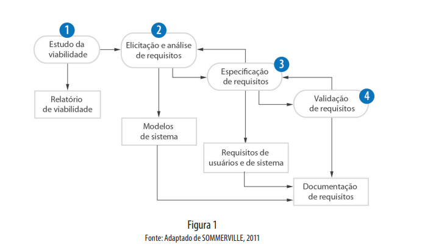
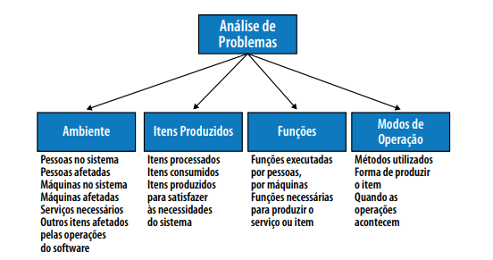

# Engenharia de Requisitos

A **Engenharia de Requisitos** concentra-se em `descobrir o que deve ser desenvolvido`, e não em como 
deve ser desenvolvido.

Na **Engenharia de Requisitos de Sofware** é analisado um conjunto de dados referentes às metas e aos
objetivos do software.

- Como funcionará o Software?
- Quais são as qualidades e propriedades que deve ter para fornecer os resultados necessários?

Quando mencionamos metas e objetivos, encontramos o `propósito do software`. Dentro da indústria, 
é chamado de `complexidade de propósito`.

O design de sistemas intensivos de software pertence a uma classe de problemas conhecidos como `heréticos`.
Para exemplificar esse tipo de problema, podemos listar as seguintes situações:

- Não há formulação definitiva dos problemas.
- Não há nenhuma rega de parada já que cada solução é sucetivel de levar a novas percepções de problemas,
e o problema nunca acaba sendo resolvido interiamente.
- As soluções não são certas ou erradas, mas simplesmente melhores ou piores.
- Não há testes objetivos para determinar se uma solução é boa ou ruim.
- Não há um pre conjunto de soluções potenciais.
- Cada problema é suficientemente complexo, de forma que nenhum outro problema será idêntico.
- Problemas complexos tendem a nos induzir a erros.

## Visão Geral

A engenharia de requisitos pode ser dividida em quatro fases:

### Estágios

1. Estudo de viabilidade: É levantado se é viável o desenvolvimento software baseado no orçamento disponível e rentabilidade.
2. Elicitação e análise de requisitos: Observação e análise dos sistemas existentes, discução com os potenciais
usuários e compradores e análise de tarefas.
3. Especificação dos requisitos: Tradução das informações obitidas na fase de análise em um documento com o conjunto
de requisitos.
4. Validação dos requisitos: Verifica o realismo e a consistência do requisitos levantados, ajudando a encontrar
erros no documento. A análise é contínua, pois novos requisitos podem emergir durante o processo.

## Requisitos do Sistema

Conforme o SEBoK – System Engineering Body of Knowledgement, `Corpo de Conhecimentos em Engenharia de Sistemas 
(2011 p. 1)` –, os requisitos do sistema são todos os requisitos, no nível do sistema, que descrevem as funções 
que deve, como um todo, cumprir para satisfazer às necessidades e aos requisitos das partes interessadas. 
É expresso por uma combinação apropriada de declarações textuais, visualizações e requisitos não funcionais. 
Este último expressa os níveis de segurança, confiabilidade etc., que serão necessários.

Os requisitos do sistemas são importantes pois forma a `base da arquitetura do sistema`. Funcionando
de certa forma com uma documentação.

## Análise de Problemas - Requisitos

Para lidar com a complexidade dos problemas, a engenharia de requisitos possui técnicas como

- Abstração - Ignora detalhes para que se possa ter uma visão geral e abrangente.
- Decomposição - Envolve quebrar um conjunto de fenômenos para serem analisados separadamente. 
Tais processos nunca são perfeitos, mas uma decomposição (ou análise) bem feita, sempre nos ajuda 
a ter melhores *insights* sobre o sistema o projeto.
- Projeção - Adatar a visão  ou perspectiva de outra pessoa (cliente ou chefe) para tentar visualizar melhor
a visão de outras pessoas.

Quando falamos falomos de problemas, estamos listando um requisito. `Problema = Requisito`.

Requisitos só existem por que alguém quer alguma coisa. Os requisitos podem ser entendidos
e descritos como uma lista de recursos, funções, restrições e várias outras coisas
exigidas pro algum cliente.

Se entende como `cliente aquele que requisita o programa` ou sistema e o `usuário aqueles que vão
utilizar`, que não necessariamente são os próprios clientes.

Quem utiliza é quem sabe bem do que precisa, mas quem paga pelo programa também tem uma opinião importante.

### Componentes de uma análise de requisito

- Funcionais - Serve para indicar as atividades do sistema e ações
- Comportamentais - Demonstra a sequencia e sobreposições de funções de um sistema, em uma hierariquia de 
atividades de controle.
- Não comportamentais - Toda a parte de engenharia e de pessoas e de qualidade.

### Etapas

- Concepção - É definido o escolo e a natureza do sistema
- Elicitação - Começa a reunir e organizar os requisitos para o software.
- Elaboração - Refinamento dos requisitos reunidos e minimamente organizados.
- Negociação - São determinadas a prioridade de cada requisito e solucionado os conflitos dos requisitos.
- Especificação - Os requisitos são reunidos em um único produtos.
- Validação - É validado os requisitos
- Gerenciamento - É definido as mudanças que os requisitos devem sofrer ao longo do tempo da vida do projeto.

Componentes que comumente são levados em consideração ao se fazer uma análise de problemas/requisitos.

